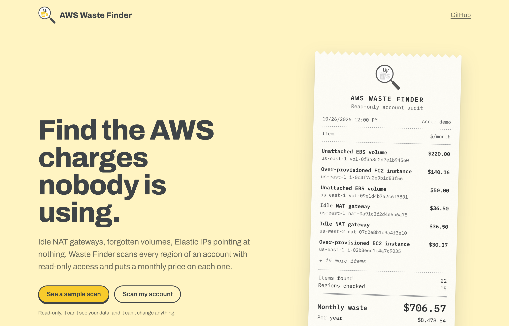
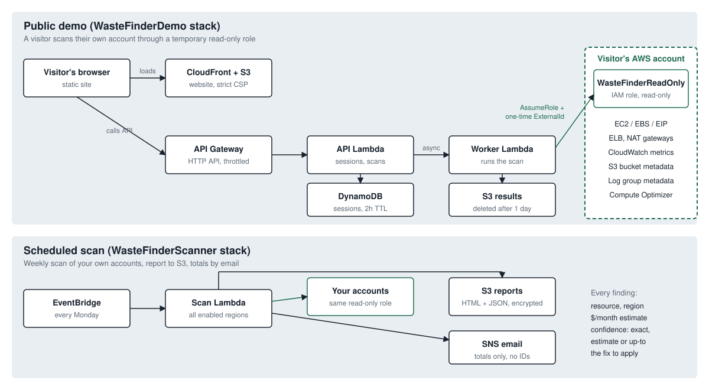

# AWS Waste Finder

A read-only scanner that finds idle and orphaned AWS resources and puts a monthly price on each one.

It checks every enabled region of one or more accounts and returns a list like "this NAT gateway has carried no traffic for 14 days and costs $36.50 a month". Each finding comes with the fix to apply and how confident the dollar figure is.



## Why this exists

AWS already has free tools for rightsizing: Compute Optimizer, Trusted Advisor and Cost Explorer. Waste Finder doesn't rebuild those. It pulls rightsizing straight from Compute Optimizer. Its own checks cover leftovers those tools underplay or leave unpriced: resources that cost money every hour and do nothing.

## What it finds

| Check | Flagged when | Price basis | Confidence |
|---|---|---|---|
| Idle NAT gateways | No traffic in or out for 14 days | $0.045/hr + public IPv4 | Exact |
| Unattached EBS volumes | Volume is `available` for 1+ day | Type, size, provisioned IOPS and throughput | Exact |
| Over-provisioned EC2 | Compute Optimizer says `Overprovisioned` | Compute Optimizer's own savings estimate | Estimate |
| Idle load balancers | No registered targets, or no requests or flows in 14 days | ALB/NLB/Classic hourly rate | Exact |
| Old orphaned snapshots | 90+ days old, source volume deleted, not used by an AMI or AWS Backup | $0.05/GB-month of source volume | Up to |
| gp2 volumes | Attached gp2 volume | gp2 vs gp3, including IOPS above 3,000 | Exact |
| Log groups that never expire | No retention setting, 0.5 GB+ stored | $0.03/GB-month stored | Up to |
| Long-stopped instances | Stopped 30+ days | Cost of attached EBS volumes | Exact |
| Abandoned multipart uploads | Upload started 7+ days ago, never finished | S3 Standard rate on measured part sizes | Estimate / Up to |
| Unused Elastic IPs | Not associated with anything | $0.005/hr per public IPv4 | Exact |

*Exact* means a fixed list price. *Estimate* is based on usage or AWS's own recommendation. *Up to* means the real saving is that amount or less: snapshots are incremental, and setting a log retention period only removes data older than the window.

Prices are us-east-1 on-demand list prices (`src/waste_finder/pricing.py`). Other regions are usually within a few percent. Treat totals as an estimate, not a bill.

## Security model

- **Read-only, metadata only.** The scanning role ([`cloudformation/readonly-role.yaml`](cloudformation/readonly-role.yaml)) can describe resources and read CloudWatch metrics. It has no `s3:GetObject` and no log-event access. It can't create, change or delete anything. A test fails the build if a non-read action is ever added.
- **Confused-deputy protection.** Cross-account access requires both the scanner's exact role ARN and a unique ExternalId. In the public demo, each visitor gets a fresh ExternalId.
- **Short-lived demo data.** Demo sessions expire after 2 hours (DynamoDB TTL), and results are deleted after 1 day (S3 lifecycle). A session can run at most 3 scans. The API is throttled.
- **No secrets in email.** The scheduled email contains totals only. Resource IDs stay in the report, which is encrypted in S3 and needs AWS sign-in to open.
- **Website.** Served from a private S3 bucket through CloudFront with a strict Content-Security-Policy: no third-party scripts and self-hosted fonts. All scan data is rendered as text, never as HTML.
- **Isolation.** One failing check, region or account never stops the rest. Failures show up as notes in the report.

## Architecture



Two CDK stacks share the same scanner code:

- **`WasteFinderScanner`**: EventBridge runs a Lambda every Monday. It scans your accounts and writes an HTML and JSON report to S3. It then emails a summary through SNS.
- **`WasteFinderDemo`**: the public "scan your own account" site. CloudFront serves the site, API Gateway and Lambda run the API, and DynamoDB holds sessions. An async worker Lambda assumes the visitor's temporary read-only role.

## Quick start

### Run it locally

```bash
pip install -e .
waste-finder                                  # current credentials, all enabled regions
waste-finder --regions us-east-1 --html report.html
```

Your credentials need the permissions listed in `cloudformation/readonly-role.yaml`.

### Deploy the weekly scan

```bash
pip install -r infra/requirements.txt
cd infra
cdk deploy WasteFinderScanner --context notifyEmail=you@example.com
```

Confirm the SNS subscription email. Optional context:

| Context | Meaning |
|---|---|
| `targetAccountIds` | Comma-separated accounts to scan (default: the deploying account) |
| `scanRegions` | Comma-separated regions (default: all enabled) |
| `externalIdParameter` | SSM SecureString name holding the ExternalId for other accounts |

To scan other accounts, deploy `cloudformation/readonly-role.yaml` in each one. Use the `ScannerRoleArn` stack output and your ExternalId as parameters.

### Deploy the public demo

```bash
cd infra
cdk deploy WasteFinderDemo --context enableDemo=true \
  --context allowedOrigins=https://your-site.example
```

The `SiteUrl` output is the website. Its `config.json` is generated during deployment and points the site at the API. Without that file, the site runs in sample-only mode.

## Running cost

Both stacks are serverless and idle almost all the time. A weekly scan of one account runs for a minute or two of Lambda time and makes a few hundred API calls; CloudWatch `GetMetricStatistics` is the only paid call, at fractions of a cent per scan. The demo stack costs effectively nothing when nobody is using it.

## Development

```bash
pip install -r requirements-dev.txt
pytest -q                     # checks, scanner, handlers, API and infrastructure (mocked AWS)
cd infra && cdk synth --context enableDemo=true
```

To add a check, write a function in `src/waste_finder/checks/` decorated with `@regional("id")` or `@global_check("id")` that returns a list of `Finding`s. Then add a test and its permissions to both the role template and `READ_ONLY_ACTIONS`.

## Limitations

- Prices are static list prices. Savings Plans, Reserved Instances and enterprise discounts aren't applied.
- Rightsizing appears only if Compute Optimizer is turned on in the account. It's free; the report says so when it's off.
- The checks flag likely waste. Confirm before deleting anything, since some idle resources exist on purpose, such as disaster-recovery standbys.

## License

MIT. See [LICENSE](LICENSE).
